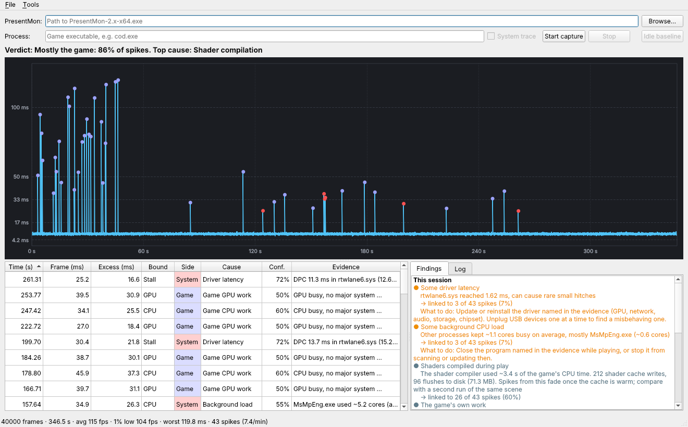
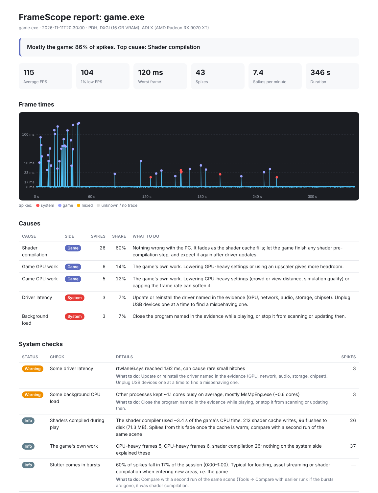

# FrameScope

**Is the stutter coming from your PC or from the game?**

FrameScope records every frame of a game, finds the stutter spikes, and checks what your system
was doing during each one: drivers, CPU scheduling, memory, storage, GPU clocks, background
programs, shader compilation. Every spike gets a likely cause, and the session gets a verdict.



- No injection and no overlay: everything comes from Windows' own tracing (ETW), so it works
  alongside anti-cheat.
- Portable: unzip and run. One settings file next to the exe, nothing else.
- Windows 10/11, x64. NVIDIA and AMD graphics cards.

> **Beta.** The analysis has been checked on a handful of real captures, all on AMD hardware.
> The NVIDIA side, frame generation and shader-compile detection are built from documentation
> and simulated data and still need confirmation on real systems. Reports with
> **Tools → Save diagnostics** attached are very welcome.

## Download

Get the latest build from the [Releases](https://github.com/KaroqDave/FrameScope/releases) page.

| Package | For | AMD GPU sensors |
|---|---|---|
| `FrameScope-…-windows-x64.zip` | Everyone | No (NVIDIA sensors work) |
| `FrameScope-AMD-…-windows-x64.zip` | PCs with an AMD CPU or GPU | Yes; comes with `EULA-AMD.txt`, which AMD's license requires |

You also need the PresentMon console app (`PresentMon-2.x-x64.exe`) from
[PresentMon's releases](https://github.com/GameTechDev/PresentMon/releases).

## Quick start

1. Unzip FrameScope anywhere and start `framescope.exe`. It asks for admin rights, which the
   system trace needs.
2. Point it at the PresentMon exe (**Browse…**), once.
3. Optional: press **Idle baseline** with no game running. 30 seconds later you know whether
   the PC has problems before a game even starts.
4. Enter the game's exe name (e.g. `helldivers2.exe`), keep **System trace** ticked, press
   **Start capture**, and play. Minimise FrameScope while you do.
5. Press **Stop**. Read the verdict, the spike table and the **Findings** tab.

Each spike gets its cause about 4 seconds after it happens.

## Reading the results

**Verdict:** one line, e.g. *Mostly the game: 86% of spikes. Top cause: Shader compilation.*

**Graph:** frame times with a dot per spike. Red = your system, violet = the game, amber =
could be either, white = not explained (yet). Mouse wheel zooms, drag pans, double-click
follows live.

**Spike table:** one row per spike with side, cause, confidence and the evidence. Hover a row
to see what to do about it. Click a row to jump to it in the graph.

**Findings:** checks over the whole session, worst first. Each one says how many spikes it is
linked to and what to do.

### Causes

| Cause | Side | What to do |
|---|---|---|
| Driver latency | System | Update or reinstall the driver named in the evidence; unplug USB devices one at a time |
| GPU throttling | System | Check temperatures, fan curve, airflow, power cables |
| CPU throttling | System | Power plan, CPU cooling, BIOS power limits |
| Low memory | System | Close memory-hungry programs or add RAM |
| Background load | System | Close the program named in the evidence while playing |
| CCD scheduling | System | AMD chipset driver, Game Bar and Game Mode on (dual-CCD X3D CPUs) |
| VRAM full | Mixed | Lower texture quality or resolution |
| Storage wait | Mixed | Fast SSD, check the drive; otherwise the game is streaming |
| Hard page faults | Game | The game is loading data; a fast SSD helps |
| Shader compilation | Game | Fades as the shader cache fills; returns after driver updates |
| Game CPU work / Game GPU work | Game | The game's own work; lower the matching settings |
| Unexplained wait | Unknown | Capture again with the full trace; try without V-Sync or limiters |

"Likely cause" means: this is what the system data during that frame points to. It is strong
evidence, not proof.



## Features

| Feature | Where | What it does |
|---|---|---|
| Idle baseline | Button / Tools menu | 30 s system check without a game |
| Sessions | File → Save / Open session | `.fscope` files with frames, spikes, causes and findings |
| Report | File → Export report | One self-contained HTML file to keep or share |
| Run comparison | Tools → Compare with earlier run | Two runs of the same scene: fewer spikes on run 2 means shader compilation, spikes at the same moments mean game content, random spikes point to the system |
| Frame generation | automatic | AFMF, FSR-FG, XeSS-FG and DLSS-FG are recognised; spikes and FPS always describe the frames the game rendered, with FPS on screen shown separately |
| Display pacing | automatic | Hitches on screen that the game's frame times don't show |
| Light system trace | Tools menu | Less overhead; shader compilation is then not detected |
| Diagnostics | Tools → Save diagnostics | One text file with everything needed to debug a capture |
| Open by file | drag a `.fscope` or CSV onto the exe | Opens it directly |

### Command line

```sh
framescope-cli capture.csv --top 10                      # analyse a PresentMon CSV
framescope-cli session.fscope --report report.html       # HTML report from a session
framescope-cli run1.fscope --compare run2.fscope         # compare two runs
framescope-latency --seconds 30                          # driver latency check, as admin
```

## NVIDIA and AMD

Every check exists for both vendors; only the source differs.

| Check | NVIDIA | AMD |
|---|---|---|
| Clock, temperature, power, load | NVML, from the driver | ADLX, from the driver (AMD package) |
| GPU throttling | Reported by the driver | Inferred from clock drops under full load |
| Temperature near its limit | Within 3 °C of the driver's slowdown threshold | Hotspot ≥ 105 °C |
| Shader compilation | Sampling of `nvgpucomp64.dll` | Sampling of `amdxc64.dll` |
| Frame generation | DLSS-FG / MFG, found in the present pattern | AFMF and FSR-FG, labelled by PresentMon |
| V-Cache CCD check | n/a | Dual-CCD X3D CPUs (e.g. 9950X3D) |

## FrameScope's own footprint

A stutter tool must not cause stutter.

- On CPUs where one CCD has the 3D V-Cache, FrameScope and PresentMon are pinned to the other
  cores.
- Nothing is drawn while the window is minimised.
- The finding **FrameScope's own load** shows how many CPU cores measuring used and whether
  Windows had to drop trace events.
- **Files:** `framescope.ini` next to the exe (or in `%LOCALAPPDATA%\FrameScope` if that folder
  isn't writable). Everything else is written only when you save it. Traces stay in memory.
- **While capturing,** Windows runs two trace sessions (`FrameScope-Kernel`, `FrameScope`).
  They end with the capture, and are cleaned up if FrameScope crashes.

## Reporting a problem

Use **Tools → Save diagnostics** right after the capture and attach the file to a
[GitHub issue](https://github.com/KaroqDave/FrameScope/issues), together with the `.fscope`
session if you can. The diagnostics contain your Windows version, CPU layout, GPU name, driver
names, the names of programs that showed up as background load, and file paths (PresentMon,
the settings file, saved files), which can include your Windows user name. Have a look before
posting it publicly.

## Building

Requirements: CMake ≥ 3.25, a C++23 compiler (MSVC 17.8+ or GCC 13+), Qt ≥ 6.4 (Widgets).

```sh
cmake -S . -B build -G Ninja -DCMAKE_BUILD_TYPE=Release
cmake --build build
ctest --test-dir build
```

| Option | Default | |
|---|---|---|
| `FRAMESCOPE_BUILD_GUI` | `ON` | The Qt application |
| `FRAMESCOPE_BUILD_CLI` | `ON` | `framescope-cli`, `framescope-latency` |
| `FRAMESCOPE_BUILD_TESTS` | `ON` | Unit tests (no Qt needed) |
| `FRAMESCOPE_WITH_ADLX` | `ON` with MSVC | AMD GPU sensors; downloads AMD's ADLX SDK at configure time |

The analysis core is plain C++ and also builds on Linux, which is what the tests run on. The
capture side is Windows only.

How the detection works, with all thresholds: [docs/HOW-IT-WORKS.md](docs/HOW-IT-WORKS.md).

## License

FrameScope is released under the [MIT License](LICENSE).

The release packages also contain Qt (LGPL v3) and, in the AMD package, code from AMD's ADLX
SDK under AMD's own license; see `THIRD-PARTY-NOTICES.txt` and `EULA-AMD.txt` in the packages.
PresentMon is not included; it is a separate download under the MIT license.
